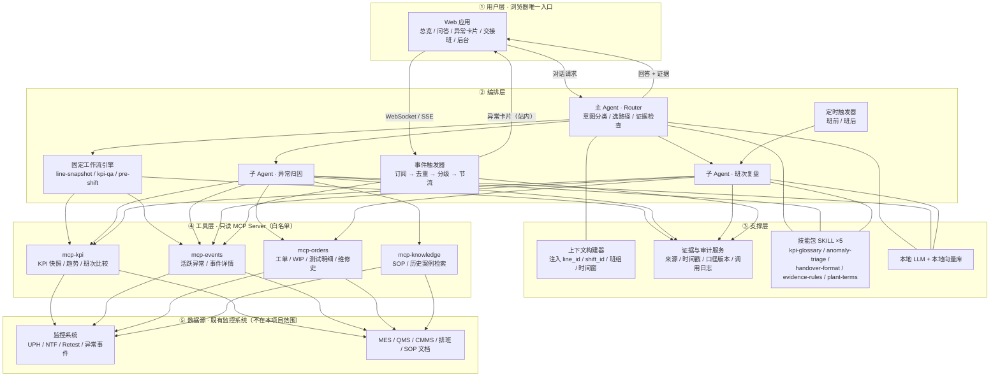
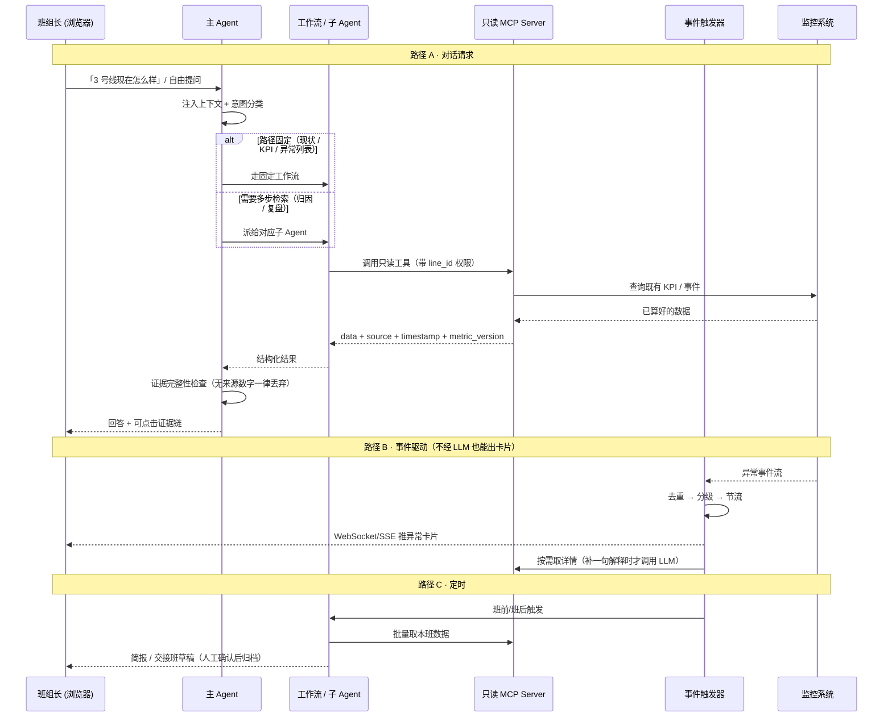

# 02 · 总体架构设计

> 配套：[01 需求说明书](01-需求说明书.md) · [03 部件清单与接口](03-部件清单与接口.md) · [04 落地路线与验收](04-落地路线与验收.md)

## 1. 三条设计取舍（先定取舍，再定部件）

| # | 取舍 | 理由 |
|---|---|---|
| D-1 | **只读适配层取代整个数采层**：把监控系统包成 4 个 MCP Server，Agent 不直连数据库、不碰 PLC | 监控系统已有 KPI 与异常结果；适配层把接口变化隔离在 Server 内，同时收口鉴权/限流/审计 |
| D-2 | **本地模型 ⇒ 少子 Agent、强工具、弱规划**：数值比较、阈值判断、排序、口径一致性全下沉到工具和规则，模型只做意图路由与语言组织 | 本地模型上下文与并发有限，多 Agent 协调成本常大于收益；确定性动作交给代码更准更省 token |
| D-3 | **纯 Web 无旁路 ⇒ 事件与对话分成两条独立路径**，事件只走站内 WebSocket/SSE | 异常要主动可见，但不允许外部推送；事件卡片不经过 LLM 也能生成，避免模型成为时延与故障单点 |

**推论**：这是一个「**薄 Agent + 厚工具层 + 强契约**」的架构，而不是多智能体协作系统。

---

## 2. 分层架构



**边界说明**：L4 是既有系统，本项目只通过只读接口消费；L3 是唯一出口，L1/L2 **没有任何直连数据库或控制网的通道**。

---

## 3. 部件总表

| 部件 | 类型 | 数量 | 职责 | 是否用 LLM |
|---|---|---|---|---|
| 主 Agent（Router） | Agent | 1 | 意图分类（现状/异常/归因/复盘/知识）、选路径、组装答案、强制附证据 | 是（轻量） |
| 异常归因 Agent | 子 Agent | 1 | 按事件码关联趋势、测试明细、工单、维修史、案例、SOP，输出四段式归因 | 是 |
| 班次复盘 Agent | 子 Agent | 1 | 长窗口汇总、交接班草稿、遗留问题清单；独立上下文 | 是 |
| 固定工作流引擎 | 工作流（非 Agent） | 3 条 | 现状速览 / KPI 问答 / 班前简报：固定调 2~3 个工具 → 套模板 → 润色 | 仅润色 |
| 技能包 | SKILL.md | 5 | 口径、分级、简报格式、证据规则、厂内黑话 | 否（纯文本） |
| MCP Server | 只读适配层 | 4 | 把监控系统/业务系统包成工具，收口鉴权、限流、超时、审计 | 否 |
| 上下文构建器 | 服务 | 1 | 从登录态注入 `line_id/shift_id/班组/时间窗`，缓存近期事件 | 否 |
| 事件触发器 | 服务 | 1 | 订阅异常 → 去重/分级/节流 → 卡片 → 站内推送 | 否 |
| 证据与审计服务 | 横切服务 | 1 | 记录问答、工具调用、写操作、口径版本；提供可点击追溯链接 | 否 |
| Web 应用 | UI + 后端 | 1 | 唯一入口：总览、问答、异常卡片、交接班、后台 | 否 |

**为什么只拆 2 个子 Agent**：只有「需要独立长上下文 + 多步工具调用 + 不同判断角色」时才值得拆。现状速览这类固定路径用工作流更快更稳；本地模型下多 Agent 协调成本往往大于收益。

---

## 4. 三条独立运行路径



| 路径 | 触发 | 是否经过 LLM | 目标时延 |
|---|---|---|---|
| A 对话 · 固定 | 点快捷按钮 / 常见问法 | 仅最终润色 | P95 ≤ 2 s |
| A 对话 · 开放 | 自由文本归因提问 | 是（子 Agent） | P95 ≤ 15 s |
| B 事件 | 监控系统异常事件 | 否（可选补一句解释） | ≤ 5 s |
| C 定时 | 班前 / 班后 | 是 | 非实时，可分钟级 |

> 三条路径**不要都塞进对话**：事件卡片如果依赖 LLM 生成，模型抖动就会让告警消失，这在现场不可接受。

---

## 5. 典型场景执行链

| 场景 | 路径 | 调用链 | 输出 |
|---|---|---|---|
| 「3 号线现在怎么样」 | 工作流 `line-snapshot` | `get_kpi_snapshot` + `get_active_anomalies` + `get_work_order` → 模板 → 润色 | 一屏卡片，3 个数字各带证据 |
| 「NTF 跟上一班比如何」 | 工作流 `kpi-qa` | `compare_shift(line, 本班, 上一班, metric=NTF)` → 模板 | 工具算好的差值与结论，**模型不做减法** |
| 「为什么 NTF 升高」 | 子 Agent `anomaly-rca` | `get_kpi_trend` → `get_test_records` → `get_work_order` → `get_equipment_history` → `get_similar_cases` → `search_sop` | 可能原因 + 证据 + 建议 + 不确定项 |
| 监控系统报停机 5 分钟 | 事件触发器 | 去重/分级/节流 → 卡片 → WebSocket | 红卡 + 事件码 + 起止时间 + 原始记录链接 |
| 班后交接 | 子 Agent `shift-review` | 批量拉本班 KPI/异常/未闭环项 → 套 `shift-handover-format` | 草稿；班长编辑确认后归档 |

---

## 6. 关键设计决策（ADR 摘要）

| ADR | 决策 | 备选方案 | 选择理由 / 代价 |
|---|---|---|---|
| ADR-01 | 监控系统经 MCP Server 只读接入，Agent 不直连 DB | Agent 直接查库 | 接口变化只改 Server；权限/限流/审计统一收口。代价：多一层适配开发 |
| ADR-02 | 1 主 + 2 子 Agent，不做多 Agent 投票/反思循环 | 5~8 个专职 Agent | 本地模型算力与上下文有限，现场要求快；代价：归因深度受限于单个 Agent |
| ADR-03 | 高频固定场景走工作流，不交给 LLM 规划 | 全部交给主 Agent 自主规划 | 快、稳、可预测、省 token；代价：新场景需新增工作流配置 |
| ADR-04 | 口径写在 `kpi-glossary` SKILL，不在代码里硬编码 | 写进提示词 / 配置代码 | 口径变更只改文本；代价：依赖技能描述写得准确、需实测触发 |
| ADR-05 | 模型不产生数字，只组织语言 | 让模型读原始数据自行汇总 | 消除幻觉数值；代价：工具层要覆盖所有需要的比较与聚合 |
| ADR-06 | 事件卡片由规则引擎生成，LLM 只补解释 | LLM 生成卡片 | 模型故障不影响告警可见性；代价：卡片文案较模板化 |
| ADR-07 | 站内 WebSocket/SSE，不做任何外部通知 | 企微/钉钉/短信旁路 | 遵循需求方「无需消息旁路」；代价：离屏即失联（已接受） |
| ADR-08 | 一期零写工具 | 直接支持回写停机原因/建维修单 | 安全与信任优先；代价：闭环需人工在既有系统操作 |
| ADR-09 | 中间结果以结构化数据 + 审计记录传递，不靠 Agent 记忆共享 | 子 Agent 共享对话上下文 | 子 Agent 上下文隔离，避免污染与串线；代价：需显式设计输出契约 |

---

## 7. 明确不包含的部件

| 排除项 | 原因 |
|---|---|
| 数采网关 / OPC UA / 点位映射 / 边缘缓存 | 监控系统已具备 |
| KPI 计算服务、异常检测、预测模型 | 与既有系统重复，且会造成两套口径 |
| 写工具、设备控制、参数下发、工单回写 | 一期只读；设备参数下发建议**永久排除** |
| 外部通知适配器、移动端 | 需求方明确无消息旁路、Web 唯一入口 |
| 多 Agent 投票、自我反思、自动规划器 | 本地模型 + 现场低时延，收益不抵成本 |
| 公网模型 API、公有云向量库、第三方分析 | 数据不出厂 |

> 预留扩展位（本期不实现）：`events/notification_adapter`（若将来允许「仅提醒」旁路）、`tools/mcp-write`（三期写操作，带人工审批）。

---

## 8. 四条硬约束（写进代码评审清单）

1. **每个数字可点回监控系统原始记录**；模型只组织语言，不产生数字。
2. **口径版本化**：定义变更留版本与时间；跨版本对比必须提示或禁用。
3. **降级明确**：数据源不可用显示「数据源不可用，最后更新 xx」，绝不编造、绝不用历史值冒充实时。
4. **全链路本地**：LLM、向量库、审计库、Web 均不出厂；无外网调用、无遥测、无消息旁路。

---

## 9. 目录与实现的对应关系

```
plant-line-agent/
├── docs/                        本文档集
├── agents/agent-definitions.md  → ADR-02 的 3 个 Agent 定义
├── skills/                      → ADR-04，5 个 SKILL.md
├── tools/mcp-tool-schemas.json  → ADR-01 / ADR-05，4 个只读 Server
├── workflows/workflows.yaml     → ADR-03，3 条固定工作流
├── config/plant-agent.yaml      → 口径版本、ACL、降级、事件规则
└── web/web-ui-spec.md           → Web 页面与站内推送
```
